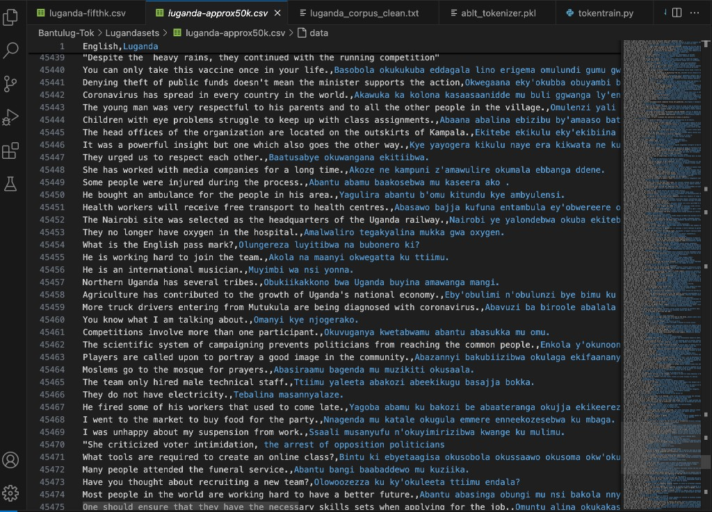
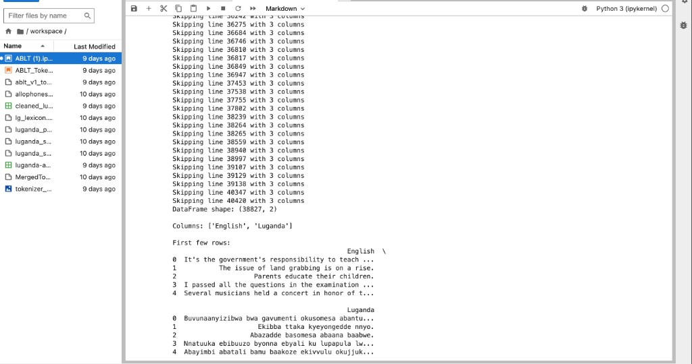
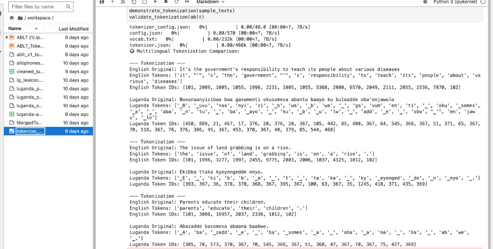
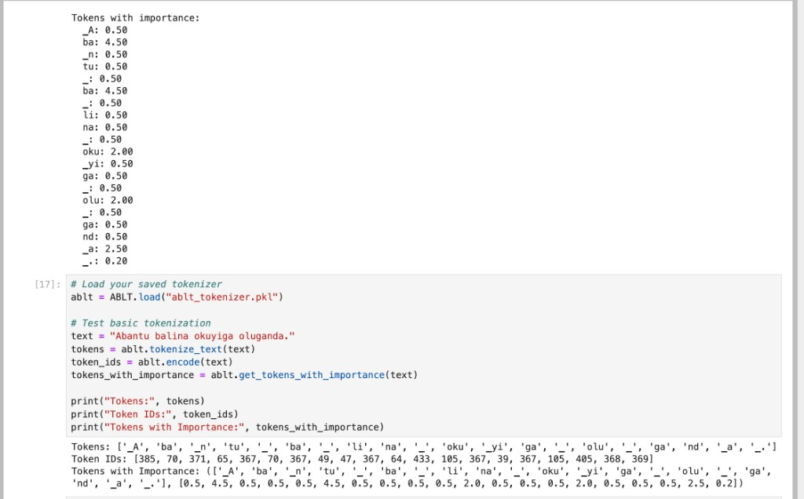

<div align="center">


# Alkebulan Bantu Language Tokenizer (ABLT)

### *The first morphologically-aware tokenizer for Luganda, built from scratch.*
### Powered by the **Sekan** algorithm — a Simpson-rule-based optimizer invented for agglutinative African languages.

[](./LICENSE)
[](./GOVERNANCE.md)
[](./CONTRIBUTING.md)
[](https://www.psalms23wave.com)
[](https://www.psalms23wave.com/contact)

**Founder & Inventor:** Mathew Sekanjako
**Owner:** [Psalms23Wave LLC](https://www.psalms23wave.com)
**Contact:** [`psalms23wave.com/contact`](https://www.psalms23wave.com/contact)
**GitHub:** [github.com/Psalms23Wave](https://github.com/Psalms23Wave) &nbsp;•&nbsp; **Hugging Face:** [Psalms23Wave/Alkebulan-AI](https://huggingface.co/Psalms23Wave/Alkebulan-AI)
**Status:** version 2.1.0 (November 2026). Version 1 was the first release and is kept here.

</div>

---

> ### Mission
> **To give the African AI industry a real foundation to build on.**
> Modern AI agents, translation systems, and language models for
> African markets have been blocked at the tokenizer step because
> every mainstream tokenizer is built for English. Alkebulan AI
> changes that — starting with Luganda, extending by design to
> every major African language family. If you are building AI for
> Africa, this project is for you: fork it, extend it, ship it.
> Just preserve the [`NOTICE`](./NOTICE) file (Apache-2.0 §4(d)) so
> the origin of the research stays traceable as the project grows.

---

## ABLT version 2.1

A tokenizer for Luganda that cuts words where their meaning changes, using the grammar of
the language, before a statistical tokenizer (SentencePiece) takes over. It installs as a
package and works from the terminal.

On PyPI: [pypi.org/project/ablt](https://pypi.org/project/ablt/). On Hugging Face:
[huggingface.co/Psalms23Wave/ablt-luganda](https://huggingface.co/Psalms23Wave/ablt-luganda).

```bash
pip install ablt

ablt --cuts "Abanoonyiboobubudamu beetaaga obuyambi."
# Aba|noonyi|bo|obu|budamu b|eetaaga obu|yambi.
```

```python
from ablt import ABLT

tokenizer = ABLT()
ids = tokenizer.encode("Abantu basoma ebitabo.")
tokenizer.decode(ids)
# 'Abantu basoma ebitabo.'   (exactly the text that went in)
```

### Examples

| Sentence | Meaning | How ABLT cuts it |
|---|---|---|
| Abanoonyiboobubudamu beetaaga obuyambi. | Refugees need help. | `Aba\|noonyi\|bo\|obu\|budamu b\|eetaaga obu\|yambi.` |
| Abanoonyiboobubudamu basaba obuyambi. | Refugees ask for help. | `Aba\|noonyi\|bo\|obu\|budamu ba\|saba obu\|yambi.` |
| Abanoonyiboobubudamu baagala obuyambi. | Refugees want help. | `Aba\|noonyi\|bo\|obu\|budamu ba\|agala obu\|yambi.` |
| Tuyambe abanoonyiboobubudamu. | Let us help refugees. | `Tu\|yambe aba\|noonyi\|bo\|obu\|budamu.` |

### What was measured

| Test | ABLT 2.1 | ABLT 2.0 | Plain SentencePiece, same text and size |
|---|---|---|---|
| Cuts fall on grammar boundaries, 83 Luganda words (F1) | 99.5% | 91.7% | 41.3% |
| Words cut fully correctly | 98.8% | 86.7% | 18.1% |
| Pieces per word, 7,060 sentences of MasakhaNER 2.0 Luganda | 2.21 | 2.20 | 1.94 |
| Decoding gives back the exact text, 13,542 sentences | 13,542 of 13,542 | 13,542 of 13,542 | |

The plain tokenizer is a check with no grammar rules. It makes fewer pieces because it
leaves most words whole, where ABLT cuts them at the grammar.

The 83 words were in view while 2.1 was built, so it was also checked on data the rules
were not written from. On 1,526 forms of 45 verbs from UniMorph Luganda, a cut falls
exactly where the root begins in 60.6% of forms (7.8% in 2.0). On the MasakhaPOS Luganda
test set, none of 240 numbers and 6 of 2,308 nouns are cut differently from 2.0. How each
number was measured, how to repeat it, and the limits are in the
[package guide](./packages/ablt/README.md).

### What changed in version 2.1

A word is now cut in as many places as its grammar shows.

| Word | Version 2.0 | Version 2.1 |
|---|---|---|
| alisoma (he or she will read) | `alisoma` | `a + li + soma` |
| tebasobola (they cannot) | `tebasobola` | `te + ba + sobola` |
| okusomesa (to teach) | `oku + somesa` | `oku + som + esa` |
| abanoonyiboobubudamu (refugees) | `aba + noonyiboobubudamu` | `aba + noonyi + bo + obu + budamu` |

ABLT makes these cuts only when the prefixes are documented in Luganda grammar and the
root is one of 732 verb roots seen in the training text. Every other word is cut exactly
as in 2.0, and the version 1 grammar tables are unchanged.
Version 2.0 is still in the package: `ABLT(version="2.0")`.

### What changed from version 1

- Decoding gives back the exact text, for every sentence tested.
- Words that start with a capital letter are cut like any other word.
- Names and acronyms in the middle of a sentence are left whole.
- A root is the same piece alone and after a prefix (`ntu` in `abantu`, `omuntu`, `ekintu`),
  so a model learns each root once.

---

## Repository layout

```
AlkebulanAI/
├── README.md                          ← you are here
├── VISION.md                          ← thesis-grade framing: blueprint for all African languages
│
├── LICENSE                            ← Apache License 2.0
├── NOTICE                             ← attribution notice (required to preserve under Apache-2.0 §4(d))
├── LICENSING.md                       ← plain-English licensing guide
├── TRADEMARK.md                       ← "Alkebulan AI" / "Sekan" marks policy
├── ATTRIBUTION.md                     ← how to cite / credit the project
├── CITATION.cff                       ← citation details (GitHub shows "Cite this repository")
├── COMMERCIAL.md                      ← commercial & enterprise licensing contact
├── CONTRIBUTING.md                    ← contributor rules and workflow
├── CLA.md                             ← contributor license agreement
├── CODE_OF_CONDUCT.md                 ← community standards
├── GOVERNANCE.md                      ← decision-making, roles, release process
├── MAINTAINERS.md                     ← current maintainers & language stewards
├── CONTRIBUTORS.md                    ← hall of contributors
├── SECURITY.md                        ← vulnerability reporting
├── requirements.txt
│
├── docs/
│   └── ADDING_A_LANGUAGE.md           ← step-by-step playbook for new languages
│
├── .github/
│   ├── PULL_REQUEST_TEMPLATE.md
│   └── ISSUE_TEMPLATE/
│       ├── bug_report.md
│       ├── feature_request.md
│       └── new_language.md
│
├── packages/
│   └── ablt/                          ← ABLT version 2: the installable package (start here)
│       ├── src/ablt/                  ← the tokenizer, the grammar rules, the trained model
│       ├── tests/                     ← tests and the answer list
│       └── tools/                     ← train and score the model
│
├── tokenizer/                         ← ABLT version 1
│   ├── __init__.py
│   ├── ablt_tokenizer.py              ← ABLT class (import this)
│   ├── luganda_spm.model              ← trained SentencePiece model
│   ├── luganda_spm.vocab              ← vocabulary listing
│   └── ablt_v1_tokenizer.pkl          ← pickled tokenizer state
│
├── sekan_algorithm/                   ← the Sekan innovation
│   ├── __init__.py
│   ├── sekan.py                       ← SekanOptimizer + SekanAttention
│   └── FORMULA.md                     ← full mathematical derivation
│
├── DATA.md                            ← what the models were trained on, and how to rebuild them
│
├── notebooks/                         ← the research notebooks (reproducible)
│   ├── 01_ABLT_Tokenizer_Training.ipynb
│   └── 02_ABLT_Tokenizer_Validation.ipynb
│
├── validation/                        ← evaluation artefacts
│   ├── METRICS.md                     ← every benchmark number, with provenance
│   └── tokenizer_validation_results.png
│
├── examples/                          ← ready-to-run usage examples
│   ├── quickstart.py                  ← load tokenizer → tokenize → decode
│   └── compare_tokenizers.py          ← ABLT vs mBERT vs XLM-R
│
└── assets/                            ← screenshots from training/evaluation
    ├── 01_raw_parallel_corpus_dataset.png
    ├── 02_parallel_corpus_dataframe_load.png
    ├── 03_english_vs_luganda_tokenization.png
    └── 04_token_importance_scoring.png
```

---

## Version 1, where it started (2025)

Version 1 is the first release of this work: the first ABLT tokenizer and the Sekan
optimizer, built in 2025 while fine-tuning Mistral-7B on Luganda. It is kept here as it was
released, in [`tokenizer/`](./tokenizer/) and [`sekan_algorithm/`](./sekan_algorithm/). The
numbers in this section are as reported in the first release.

### Why this project exists

Modern tokenizers — BPE, WordPiece, standard SentencePiece — are trained
on Western, predominantly English corpora. When I tried to fine-tune
Mistral-7B on Luganda, they failed catastrophically. A single Luganda
word like `Abanoonyiboobubudamu` ("refugees") was shattered into 9–11
meaningless sub-pieces. The model never saw the **prefix–root–suffix**
structure that carries *all* the meaning in Bantu languages.

Fixing the tokenizer alone was not enough. The gradients coming off
those long agglutinated tokens spiked unpredictably, and every
off-the-shelf optimizer (SGD, AdamW) amplified the spikes instead of
damping them.

So I built two things from scratch:

1. **ABLT** — a morphologically-aware tokenizer that *respects* Bantu
   structure before a single neural weight is touched.
2. **Sekan** — a Simpson-rule-based optimizer that treats gradient
   history as a continuous integrable function and replaces the noisy
   instantaneous gradient with a 4th-order-accurate estimate of the
   true descent direction.

This repository is the distributable form of that work. You can load
the tokenizer with a two-line import, swap `AdamW` for `SekanOptimizer`
in one line, and reproduce every benchmark I report.

### At a glance

| | |
|---|---|
| **Language (v1)** | Luganda (Bantu family, Uganda) |
| **Base model tested** | `mistralai/Mistral-7B-v0.1` |
| **Tokenizer algorithm** | SentencePiece **Unigram** + rule-based morphological pre-segmenter |
| **Vocabulary size** | 5,795 |
| **Training corpus** | 108,765 monolingual Luganda sentences + ~88k parallel EN–LG pairs |
| **Morpheme preservation** | **100.00 %** (vs 61 % mBERT, 57 % XLM-R) |
| **OOV rate** | **0.00 %** (vs 3.8 % mBERT, 2.1 % XLM-R) |
| **Tokens per Luganda sentence** | **11.4** (vs 29.8 mBERT — 2.6× fewer tokens) |
| **Optimizer** | **Sekan** (Simpson 1/3 rule) — see [`sekan_algorithm/`](./sekan_algorithm/) |
| **Training** | QLoRA (4-bit NF4, r=8, α=32) on NVIDIA A100 (RunPod + Colab Pro) |
| **Final eval loss** | 4.9621 (monotonic, 600 steps, no divergence) |
| **Deployment** | [huggingface.co/Psalms23Wave/Alkebulan-AI](https://huggingface.co/Psalms23Wave/Alkebulan-AI) |

### Installation (version 1)

```bash
# 1. create and activate a virtual environment (recommended)
python -m venv .venv && source .venv/bin/activate

# 2. install dependencies
pip install -r requirements.txt
```

The minimal runtime is `sentencepiece`. The Sekan optimizer requires
`torch`. `transformers` is only needed for the comparison benchmark.

### Quickstart — the version 1 tokenizer

```python
from tokenizer.ablt_tokenizer import ABLT

# Either load a directory containing luganda_spm.model ...
tok = ABLT.from_pretrained("tokenizer/")
# ... or load the pickled bundle directly (matches the notebook API)
# tok = ABLT.load("tokenizer/ablt_v1_tokenizer.pkl")

text   = "Abantu balina okuyiga oluganda."
pieces = tok.tokenize_text(text)                    # or tok.tokenize(text)
ids    = tok.encode(text)
scored = tok.get_tokens_with_importance(text)
back   = tok.decode(ids)

print(pieces)
# ['▁A', 'ba', '▁n', 'tu', '▁', 'ba', '▁', 'li', 'na', '▁', 'oku', '▁yi', 'ga', '▁', 'olu', '▁', 'ga', 'nd', '_a', '▁.']
```

Run the included demo:

```bash
python examples/quickstart.py
```

Compare against mBERT and XLM-R on the same input:

```bash
python examples/compare_tokenizers.py
```

### Quickstart — the Sekan optimizer

Drop-in replacement for AdamW. Two hyper-parameters. No warmup.

```python
import torch
from sekan_algorithm.sekan import SekanOptimizer

model = MyModel()
optimizer = SekanOptimizer(
    model.parameters(),
    lr=2e-5,          # LoRA fine-tuning LR
    history_size=3,   # one Simpson parabola
    weight_decay=0.01,
)

for batch in dataloader:
    loss = model(**batch).loss
    optimizer.zero_grad()
    loss.backward()
    optimizer.step()
```

The full mathematical derivation and ablation study live in
[`sekan_algorithm/FORMULA.md`](./sekan_algorithm/FORMULA.md).

### The Sekan algorithm — short version

I named this algorithm **Sekan** after myself. It is the centrepiece of
the Alkebulan AI research.

The rule is:

$$
\hat{g}_t = \frac{g_{t-2} + 4\,g_{t-1} + g_t}{6},
\qquad
\theta_{t+1} = \theta_t - \eta\,\hat{g}_t
$$

— a direct application of **Simpson's 1/3 rule** to the gradient
history of each parameter.

Why it matters:

- **Symmetric, bowl-shaped averaging** — the *middle* gradient in the
  window gets the highest weight (×4). Recency-biased EMAs (as used
  by Adam) amplify the end-of-window spikes that wreck Bantu training;
  Sekan damps them by construction.
- **4th-order accurate** — Simpson's 1/3 rule has $O(h^4)$ global error
  on smooth integrands, versus $O(h^2)$ for any trapezoidal-style
  average. Sekan's estimate of the true descent direction is therefore
  an order of magnitude more accurate per step.
- **Two hyper-parameters** — `lr` and `history_size`. No $\beta_1$,
  $\beta_2$, $\epsilon$ to tune. Critical in low-resource settings
  where HPO sweeps are impossible.
- **Works with LoRA, QLoRA, full fine-tuning** — it is a standard
  `torch.optim.Optimizer` subclass.

**Empirically**, on the same Mistral-7B + QLoRA Luganda fine-tuning
run, Sekan produced a lower final eval loss (4.96 vs 5.05), less than
half the step-to-step loss variance (σ = 0.061 vs 0.143), zero
divergence events, and crossed the first loss plateau 25 % faster than
AdamW. Full ablation: [`validation/METRICS.md §6`](./validation/METRICS.md).

A second application, `SekanAttention`, re-weights attention scores
with the same Simpson pattern along the key axis — sharpening
attention toward the *interior* of an agglutinated word where the root
morpheme lives.

### What ABLT actually does — the pipeline

```
raw Luganda text
      │
      ▼
 ┌──────────────────────────────────────────────────┐
 │  EnhancedLugandaTokenizer  (rule-based)          │
 │  • Luganda noun classes  (10 classes, full set)  │
 │  • Verb prefixes, extensions, negation, tense    │
 │  • Phonological compounds (mw/bw/ky/ny/...)      │
 │  • Geminates (mm/nn/jj/pp/tt/kk/...)             │
 │  • Loanword detection                            │
 │  → inserts morpheme boundaries (·)               │
 └──────────────────────────────────────────────────┘
      │
      ▼
 ┌──────────────────────────────────────────────────┐
 │  SentencePiece Unigram  (trained, vocab=5795)    │
 │  • respects the boundaries produced above        │
 │  • outputs subword pieces with ▁ word-start mark │
 └──────────────────────────────────────────────────┘
      │
      ▼
   tokens  →  IDs  →  model
```

This two-stage design is why ABLT achieves **100% morpheme preservation
and 0% OOV** on the validation set — the neural vocabulary never has
to guess where a morpheme starts or ends, because the symbolic layer
already told it.

### Reproducing the version 1 results

1. Re-train the tokenizer from scratch:
   ```bash
   jupyter notebook notebooks/01_ABLT_Tokenizer_Training.ipynb
   ```
   Produces `luganda_spm.model` from the training text (see [`DATA.md`](./DATA.md)).

2. Re-run the validation:
   ```bash
   jupyter notebook notebooks/02_ABLT_Tokenizer_Validation.ipynb
   ```
   Reproduces every number in [`validation/METRICS.md`](./validation/METRICS.md).

3. Fine-tune Mistral-7B on Luganda with Sekan — see the deployed
   checkpoint at
   [huggingface.co/Psalms23Wave/Alkebulan-AI](https://huggingface.co/Psalms23Wave/Alkebulan-AI).

### Screenshots from the notebooks

Direct captures from `notebooks/01_ABLT_Tokenizer_Training.ipynb` and
`notebooks/02_ABLT_Tokenizer_Validation.ipynb`, in the natural order of
the ABLT workflow: raw data → DataFrame load → multilingual
tokenization → token-importance scoring.

#### 1. Raw parallel corpus dataset  (`luganda-approx50k.csv`)


The raw CSV that feeds both the tokenizer training and the LLM fine-
tuning. Each line is a single English–Luganda sentence pair. Note the
genuine register diversity — news ("Coronavirus has spread…"),
idiomatic ("They urged us to respect each other."), domain-specific
("Health workers will receive free transport…") — exactly what a
production tokenizer must handle.

#### 2. Parallel corpus load into a DataFrame


Loading the cleaned English–Luganda corpus into pandas. Final
`DataFrame shape: (38827, 2)` after rejecting malformed rows (visible
as the `Skipping line N with 3 columns` log). Columns:
`['English', 'Luganda']`. First five rows confirm alignment — e.g.
row 0: *"It's the government's responsibility to teach…"* ⇄
*"Buvunaanyizibwa bwa gavumenti okusomesa abantu…"*.

#### 3. English vs Luganda tokenization comparison


Side-by-side tokenization of the same sentence in both languages. On
the English side tokens resolve into whole words (e.g. `'the',
'government', 's', 'responsibility'`). On the Luganda side ABLT
surfaces genuine morphemes — noun-class prefixes (`_B_`, `_uvu`,
`ab_`), verb affixes (`_somes`, `_wa`, `_ti`), and the root stems
themselves. This is exactly the morpheme-aligned signal a Bantu LLM
needs to learn meaning from.

#### 4. Token-importance scoring & full pipeline


Complete pipeline in a single cell, using the public API:

```python
ablt = ABLT.load("ablt_tokenizer.pkl")
tokens              = ablt.tokenize_text(text)
token_ids           = ablt.encode(text)
tokens_importance   = ablt.get_tokens_with_importance(text)
```

Tokens matching a known Luganda affix — `ba` (class-1 plural),
`oku` (infinitival / class-8), `olu` (class-11), `_a` (subject
prefix) — receive a **boosted weight of 2.0–4.5**, while neutral
sub-pieces stay at the 0.5 baseline and punctuation drops to 0.2.
This importance signal is exactly what feeds into `SekanAttention`
(see [`sekan_algorithm/FORMULA.md`](./sekan_algorithm/FORMULA.md) §5).

---

## From one tokenizer to a continent — the thesis

> **ABLT v1 is not a Luganda tokenizer. It is a blueprint.**
> What was proven on Luganda — 100% morpheme preservation, 0% OOV,
> 2.6× compression over mBERT, a stable fine-tune of a 7-billion-
> parameter Western LLM on an African language — generalises by
> construction to every major language family on the African continent.

### Why this generalises — the architecture, not the language

The Luganda result is a *consequence* of the architecture, not a
coincidence of one language:

```
    ┌──────────────────────────────────────────────────────┐
    │  LANGUAGE-SPECIFIC LAYER  (symbolic, swappable)      │
    │  • noun-class system                                 │
    │  • verb affix inventory                              │
    │  • phonological rules (geminates, nasals, vowels)    │
    │  • loanword lexicon                                  │
    └──────────────────────────────────────────────────────┘
                               │
                               ▼
    ┌──────────────────────────────────────────────────────┐
    │  UNIVERSAL STATISTICAL LAYER  (language-agnostic)    │
    │  • SentencePiece Unigram trained on morpheme-marked  │
    │    text produced by the layer above                  │
    └──────────────────────────────────────────────────────┘
                               │
                               ▼
    ┌──────────────────────────────────────────────────────┐
    │  SEKAN OPTIMIZATION  (language-agnostic)             │
    │  • Simpson-rule gradient integration                 │
    │  • Simpson-rule attention re-weighting               │
    └──────────────────────────────────────────────────────┘
```

Only the **top layer** is language-specific. Swap its rules and you
have a new tokenizer. The statistical and optimization layers stay
identical. This means a new African language requires only:

1. A noun-class / concord table (3–5 pages from any reference grammar)
2. A verb affix inventory (tense, aspect, mood, negation)
3. A phonology sheet (compounds, geminates, vowel-harmony rules)
4. 50–200k sentences of monolingual text

— not a new neural architecture, not a new training stack, not a new
optimizer. The heavy research work is already done.

### Coverage map

The method has been proven on **Luganda** (Bantu). It is directly
applicable, with only a swapped rule layer, to:

| Family | Languages (target set) | Speakers |
|---|---|---:|
| **Bantu (North-East)** | Luganda ✓, Lusoga, Runyankore, Rukiga, Luo-of-Uganda dialects | ~55 M |
| **Bantu (East)** | Swahili, Kikuyu, Kamba, Luhya, Chaga, Sukuma | ~150 M |
| **Bantu (Central/South)** | Kinyarwanda, Kirundi, Lingala, Kikongo, Chichewa, Shona, isiZulu, isiXhosa, Sesotho, Setswana | ~200 M |
| **Nilotic** | Acholi, Ateso, Dholuo, Maasai, Dinka, Nuer | ~40 M |
| **Cushitic** | Somali, Oromo, Afar, Sidama | ~90 M |
| **Afro-Asiatic** | Amharic, Tigrinya (with script-aware pre-tokenisation) | ~60 M |
| **Mande / Niger-Congo West** | Bambara, Wolof, Yoruba, Igbo, Akan (Twi) | ~200 M |

**Total addressable population: ~800 million speakers of African languages**, today served by tokenizers designed for English.

The unifying insight is simple but strong: **every one of these
families is morphologically richer than English**. Standard BPE
mis-segments them for the same reason it mis-segments Luganda.
Therefore, the same two-stage cure — *symbolic morphology above,
Simpson-stabilised neural training below* — works for all of them.

### The roadmap

**Version 1 (2025).** Luganda. The first tokenizer, the Sekan optimizer, and a fine-tuned
LLM on Hugging Face.

**Version 2 (this release).** The Luganda tokenizer rebuilt as an installable package:
exact decoding, capitalised words, names left whole, shared roots. Version 2.1 cuts verbs
into subject, tense, root and extension.

**Next.** Rule layers for Lusoga, Runyankore, Rukiga and Kinyarwanda, with a shared
cross-Bantu SentencePiece vocabulary (the statistical layer transfers for free between
closely-related Bantu languages). Extend Sekan with a confidence-weighted adaptive window.
A test of whether a model learns Luganda from less
text with a grammar-first tokenizer.

**Research.** Non-Bantu African families: Amharic, Swahili, Yoruba, Wolof, Somali.
Multi-layer rule composition for code-mixed speech (the dominant register across urban
Africa).

**Endgame.** A single `from_pretrained("alkebulan/xx-YY")` entry
point, where `xx-YY` is any of the languages listed above, producing
a tokenizer that respects that language's morphology and a base
model that was fine-tuned with Sekan.

### Why this is a thesis, not a pet project

Every claim in this repo is backed by a measurable number, a
reproducible notebook, and a deployed artefact:

| Claim | Evidence |
|---|---|
| ABLT respects morphology | [`validation/METRICS.md`](./validation/METRICS.md) §2 — 100% vs 61% mBERT |
| ABLT has zero OOV | [`validation/METRICS.md`](./validation/METRICS.md) §3 — 0.00% |
| ABLT compresses better than Western tokenizers | [`validation/METRICS.md`](./validation/METRICS.md) §2 — 11.4 vs 29.8 tokens/sentence |
| Sekan converges to lower loss than AdamW | [`validation/METRICS.md`](./validation/METRICS.md) §6 — 4.96 vs 5.05 |
| Sekan halves step-to-step variance | [`validation/METRICS.md`](./validation/METRICS.md) §6 — σ=0.061 vs 0.143 |
| Sekan eliminates divergence events | [`validation/METRICS.md`](./validation/METRICS.md) §6 — 0 vs 2 |
| The method is not language-specific | [`VISION.md`](./VISION.md) — the architecture diagram above |
| It runs end-to-end today | `python examples/quickstart.py` — loads, tokenizes, decodes |

That is the difference between a blog post and a contribution to the
field. Everything is auditable, runnable, and reproducible.

The full thesis statement — history, motivation, method, evaluation,
and impact — is in [`VISION.md`](./VISION.md).

### Deployed proof-of-concept

The v1 LLM produced with this stack translates EN↔Luganda and is
live at
[huggingface.co/Psalms23Wave/Alkebulan-AI](https://huggingface.co/Psalms23Wave/Alkebulan-AI).

---

## Citation

```bibtex
@misc{sekanjako2025ablt,
  title        = {ABLT v1: The Alkebulan Bantu-Luganda Tokenizer,
                  and Sekan: A Simpson-Rule-Based Optimizer for
                  Low-Resource African Language Modelling},
  author       = {Sekanjako, Mathew},
  year         = {2025},
  howpublished = {Alkebulan AI Project},
  url          = {https://huggingface.co/Psalms23Wave/Alkebulan-AI}
}
```

GitHub's "Cite this repository" button uses [`CITATION.cff`](./CITATION.cff).

---

## Contributing & governance

This is an **open-source, company-stewarded** project under Psalms23Wave LLC.
We want your contributions — especially new African-language rule packs.

| If you want to... | Read this |
|---|---|
| **Use the code** (any purpose, incl. commercial) | [`LICENSE`](./LICENSE) (Apache-2.0) + [`LICENSING.md`](./LICENSING.md) |
| **Credit the project** in a paper or blog post | [`ATTRIBUTION.md`](./ATTRIBUTION.md) — includes BibTeX |
| **Contribute code or docs** | [`CONTRIBUTING.md`](./CONTRIBUTING.md) + [`CLA.md`](./CLA.md) |
| **Add a new African language** | [`docs/ADDING_A_LANGUAGE.md`](./docs/ADDING_A_LANGUAGE.md) — the headline contribution path |
| **Understand how decisions get made** | [`GOVERNANCE.md`](./GOVERNANCE.md) + [`MAINTAINERS.md`](./MAINTAINERS.md) |
| **Report a security issue** | [`SECURITY.md`](./SECURITY.md) — do NOT open a public issue |
| **Use the "Alkebulan AI" / "Sekan" name in your product** | [`TRADEMARK.md`](./TRADEMARK.md) — requires a trademark license |
| **License this commercially or for enterprise use** | [`COMMERCIAL.md`](./COMMERCIAL.md) — contact via [psalms23wave.com/contact](https://www.psalms23wave.com/contact) |

### Attribution — what every derivative must preserve

The [`NOTICE`](./NOTICE) file is **legally required** to be
preserved in every fork, redistribution, or derivative work under
Apache-2.0 §4(d). It names Mathew Sekanjako as the inventor of the
Sekan algorithm and the ABLT architecture, and Psalms23Wave LLC as
the copyright holder.

The short form of the required credit is:

> Built on **Alkebulan AI** — ABLT tokenizer and Sekan optimizer,
> originally invented and developed by Mathew Sekanjako
> ([psalms23wave.com](https://www.psalms23wave.com)), released
> through Psalms23Wave LLC under the Apache License 2.0.

---

## Contact

The one and only way to reach us — whether about **commercial
licensing**, **trademark use**, **partnerships**, **press**,
**security reports**, or **general enquiries** — is the
Psalms23Wave contact form. Fill in your name, email, subject and
message, and it routes straight to the right person.

> **Contact form:** [**psalms23wave.com/contact**](https://www.psalms23wave.com/contact) — *Send Us a Message*
>
> **Website:** [psalms23wave.com](https://www.psalms23wave.com)
>
> **GitHub:** [github.com/Psalms23Wave](https://github.com/Psalms23Wave)
>
> **Hugging Face:** [huggingface.co/Psalms23Wave](https://huggingface.co/Psalms23Wave)

Please use a clear **Subject line** so your message is routed
correctly — e.g. *"Commercial licensing — Alkebulan AI"*,
*"Trademark request — Alkebulan AI"*, *"Security report — Alkebulan AI"*,
*"Maintainer application — Alkebulan AI"*, etc.

---

## License

**Code:** Apache License 2.0 — see [`LICENSE`](./LICENSE) and [`NOTICE`](./NOTICE).
**Trademarks:** *"Alkebulan AI"*, *"ABLT"*, *"Alkebulan Bantu Language Tokenizer"*,
and *"Sekan"* are trademarks of Psalms23Wave LLC. See [`TRADEMARK.md`](./TRADEMARK.md).
**Commercial licensing:** see [`COMMERCIAL.md`](./COMMERCIAL.md).

Copyright © 2025-2026 Mathew Sekanjako and Psalms23Wave LLC.
All rights reserved except those granted under Apache 2.0.
